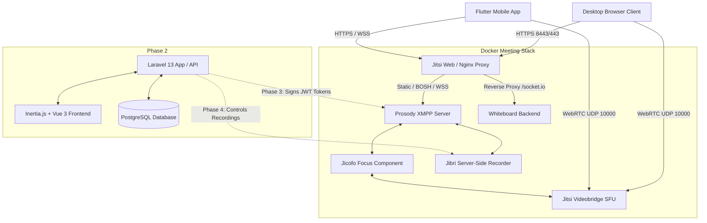

# Meet-Ark Architecture & Phase Roadmap

This document outlines the agreed multi-phase architecture for the Meet-Ark meeting platform, including service boundaries, authentication flow, networking model, and server deployment prerequisites.

---

## 1. Final Product Architecture



### Components
1. **Application Layer (Phase 2)**:
   - **Laravel 13 + Inertia.js (Vue 3)**: Official authentication scaffolding (Breeze), meeting creation, owner-scoped dashboard, link sharing, and embedded Jitsi IFrame integration.
   - **PostgreSQL 16**: Relational database storing users, meetings, and database-backed sessions.
   - *Deferred*: Redis, background workers, and schedulers deferred until specific features require them (YAGNI).
2. **Media & Real-Time Meeting Stack (Phase 1)**:
   - **Jitsi Web**: Nginx reverse proxy serving the meeting interface, TLS termination, and proxying WebSockets and Whiteboard socket.io requests.
   - **Prosody**: XMPP signaling server handling room creation, chat, participant presence, and token validation.
   - **Jicofo**: Conference focus supervisor assigning media bridges to conferences.
   - **Jitsi Videobridge (JVB)**: High-performance SFU (Selective Forwarding Unit) managing multi-party audio, video, and screen sharing streams.
   - **Excalidraw Collaboration Backend**: Socket.io server facilitating real-time multi-user drawing synchronization.
   - **Jibri**: Headless Chrome recorder encoding meetings into MP4 video (Linux-only due to kernel ALSA loopback requirement).
3. **Client Applications**:
   - Web Browsers (Chrome, Firefox, Safari, Edge) on desktop and tablet.
   - Flutter Mobile Clients (iOS & Android) in future Phase 6.

---

## 2. Implementation Phase Boundaries

| Phase | Scope | Status | Notes |
| :--- | :--- | :--- | :--- |
| **Phase 1** | **Docker Meeting Foundation** | **COMPLETE** | Pinned Jitsi `stable-9955`, Excalidraw whiteboard backend, local TLS certs, health checks, log rotation, HTTP redirect fix. |
| **Phase 2** | **App Backend & User Interface** | **COMPLETE** | Laravel 13 + Inertia Vue 3, PostgreSQL 16, database-backed sessions, auth scaffolding, meeting creation, link sharing, embedded Jitsi IFrame API. |
| **Phase 3** | **Token Security & Access Boundary** | *Upcoming* | Prosody JWT token verification module configuration, room-scoped JWT token generation in Laravel, server-enforced access boundary. |
| **Phase 4** | **Server-side Recording Integration** | *Planned* | Jibri deployment on Linux host, recording start/stop triggers from Laravel, S3/MinIO recording artifact storage. |
| **Phase 5** | **Production Deployment & Load Target** | *Planned* | Cloud Linux deployment, Let's Encrypt TLS, firewall rules, verified up to 50 concurrent participants capacity target. |
| **Phase 6** | **Flutter Mobile Clients** | *Future* | Native iOS and Android apps integrating Jitsi SDK and meeting APIs. |

---

## 3. Authentication & Security Boundary (Phase 1/2 vs Future)

### Phase 1 & Phase 2 (Local Foundation)
- Anonymous room access remains enabled on Jitsi (`ENABLE_AUTH=0`).
- Any user who visits `https://localhost:8443/<RoomName>` can enter the room directly.
- **CRITICAL LOCAL BOUNDARY NOTICE**: Laravel authentication strictly controls access to application routes (`/dashboard`, `/meetings/*`). However, in this local phase, direct Jitsi URLs are **not** restricted by Laravel login. Direct access remains anonymous until server-side token enforcement is implemented in Phase 3.
- No speculative JWT code has been introduced in Phase 2; server-enforced Jitsi access and host permissions are the planned next step before public exposure.

### Phase 3 Planned Authentication Architecture
When server-side token enforcement is implemented:

1. **Authentication Ownership**:
   - The user authenticates **only** with the Laravel application (via session, password, or SSO).
   - Jitsi never handles user passwords or database queries.
2. **Room-Scoped JWT Tokens**:
   - When a user joins a scheduled meeting, Laravel generates a cryptographically signed JWT (HMAC-SHA256 or RS256).
   - Token payload specifies:
     ```json
     {
       "iss": "meet_ark_backend",
       "aud": "meet_ark_platform",
       "sub": "meet.yourdomain.com",
       "room": "UniqueMeetingIdOrSlug",
       "exp": 1729100000,
       "context": {
         "user": {
           "id": "uuid-1234",
           "name": "Ahmed E.",
           "email": "ahmed@example.com",
           "avatar": "https://...",
           "moderator": true
         },
         "features": {
           "recording": true,
           "screen-sharing": true,
           "livestreaming": false
         }
       }
     }
     ```
3. **Prosody Token Enforcement**:
   - Prosody is configured with `AUTH_TYPE=jwt` and `JWT_APP_ID` / `JWT_APP_SECRET`.
   - Prosody validates token signature, expiration, and room binding.
   - **Prosody Privilege Reality**: A JWT payload claim (`"moderator": true`) does NOT automatically grant moderator privileges in Prosody MUC without an active, verified Prosody configuration and matching affiliations plugin (such as `mod_auth_token` or official Jitsi token verification modules). Speculative JWT code must not be assumed to work without verified Prosody module mapping.
   - Unauthenticated users or users with invalid tokens are either denied or placed in the meeting lobby depending on room settings.

---

## 4. Whiteboard Integration Architecture

- The whiteboard is powered by **Excalidraw** and the official Jitsi Excalidraw backend container (`jitsi/excalidraw-backend:21`).
- The backend runs internally on the Docker network `meet.jitsi` with network alias `whiteboard.meet.jitsi`.
- **Zero CORS / Same-Origin Setup**:
  - `web` (Nginx) reverse proxies requests matching `/socket.io/` directly to `http://whiteboard.meet.jitsi/socket.io/?$args`.
  - The browser client connects to `https://<PUBLIC_URL>/socket.io/` on the same host and port as Jitsi Meet.
  - Whiteboard drawing state updates are transmitted in real time over Socket.io WebSockets to all room participants.
- *Durable Board Storage*: Phase 1 provides real-time in-session synchronization. Permanent board saving, exporting, and reopening tied to meeting history will be handled by the Laravel application in Phase 2+.

---

## 5. Linux Server Deployment Prerequisites (Target 50 Concurrent Users)

When deploying to a public Linux host:

### Host Hardware & OS
- **OS**: Ubuntu 22.04 LTS (x86_64 or ARM64).
- **CPU**: 4+ Cores (for up to 50 concurrent participants without transcoding; add 4+ dedicated cores if Jibri recording is running concurrently).
- **RAM**: 8 GB minimum (16 GB recommended if Jibri recording is enabled).
- **Storage**: 50 GB+ SSD.

### Networking & Firewall Configuration
The following public ports must be open on the firewall / security groups:
- **80/tcp**: HTTP (Let's Encrypt ACME challenge and HTTP-to-HTTPS redirection).
- **443/tcp**: HTTPS (Web interface, XMPP WebSockets, and Whiteboard Socket.io).
- **10000/udp**: WebRTC RTP media stream transport (inbound/outbound to JVB).
- **4443/tcp**: Optional TCP media fallback if client UDP is blocked.

### Media IP Configuration
In `.env` on the server:
- `PUBLIC_URL=https://meet.yourdomain.com`
- `JVB_ADVERTISE_IPS=<SERVER_PUBLIC_IPV4>` (mandatory so remote clients receive the correct public candidate).
- `ENABLE_LETSENCRYPT=1`
- `LETSENCRYPT_DOMAIN=meet.yourdomain.com`
- `LETSENCRYPT_EMAIL=admin@yourdomain.com`

### Jibri Recording Prerequisites (Linux Host)
- Jibri requires the Linux kernel ALSA loopback module:
  ```bash
  sudo modprobe snd-aloop
  # Persist across reboots:
  echo "snd-aloop" | sudo tee -a /etc/modules
  ```
- Ensure `/dev/snd` devices are created:
  ```bash
  ls -l /dev/snd
  ```
- Start stack with recording profile:
  ```bash
  docker compose --profile recording up -d
  ```
